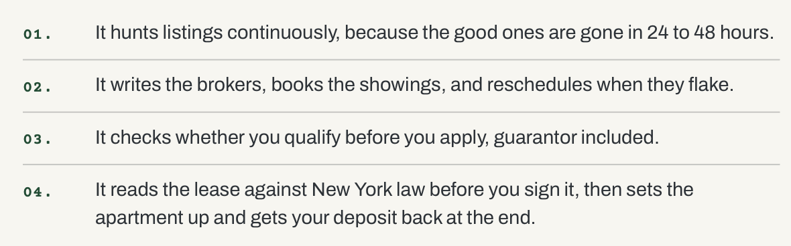
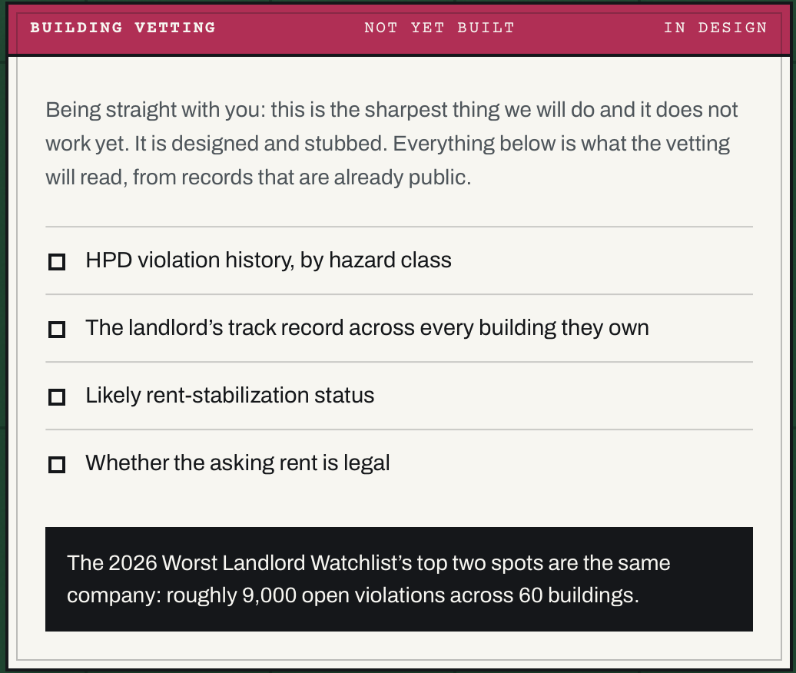

# Product Decisions

What I chose to build, what I pushed to later, and why. Newest decisions at the bottom.

## The full vision

An agent that stays on the renter's side for the whole journey, from search to move-out. Brokers are paid for the transaction, but renters need help for the whole relationship.

## Decision 1: Start at the end of the journey (#04), not the beginning

**Built now:** #04, reading the lease against New York law and helping through the tenancy to get the deposit back.

**Why:**
- **It's the part nobody serves.** Search has StreetEasy, Zillow, and brokers. After you sign, you're on your own. That gap is the whole thesis.
- **I lived it.** A landlord claimed I owed about $1,000 in repairs. I won with photos and by demanding their paper trail (what work was done, what it cost), and they ended up owing me. That tells me the product is evidence plus knowing your rights, not more advice.
- **The lease is the foundation.** Once the agent has read your lease, every later step (repairs, renewals, deposit disputes, even qualifying for the *next* place) gets smarter. Search doesn't compound like that.
- **It can be real in the time I have.** Every part of #04 can work end to end. Nothing is faked.

## Decision 2: Push #01, hunting listings, to later

**What it would be:** watch listings continuously, because good NYC apartments are gone in 24–48 hours.

**Why later:**
- **No open data source.** StreetEasy and Zillow don't offer open listing APIs. Scraping is fragile and against their terms. In a few hours I'd ship fake listings, and that's worse than not shipping.
- **It's a crowded space.** It would make the product look like another apartment finder and bury the thesis.

**What would change my mind:** a listing-data partnership or a licensed feed. Then this becomes the top of the funnel.

## Decision 3: Push #02, contacting brokers and booking showings, to later

**What it would be:** the agent writes to brokers, books showings, and reschedules when they flake.

**Why later:**
- **It needs real outreach.** Sending email or texts as the renter, reading replies, and handling calendars is a product in itself, with real trust and spam risks.
- **It depends on #01.** You can't book showings for listings you can't find.
- **High cost to get wrong.** A bad message to a broker in a hot market loses you the apartment. That needs care I can't give it in a few hours.

**What would change my mind:** once #01 exists, start with *drafting* broker messages (renter sends), then move to sending them.

## Decision 4: Push #03, checking qualification, to later (closest to "next")

**What it would be:** before you apply, check whether you qualify, guarantor included.

**Why later:**
- **It's cheap, but it's a different moment.** NYC's common rule (income of about 40× monthly rent, about 80× for a guarantor) is simple math. It belongs before signing, though, and v1 is about after.
- **Limited time goes to depth, not breadth.** One flow that fully works beats four half-built ones.

**What would change my mind:** if I finish v1 early, this is the first stretch item. It's small, honest, and needs no outside data.

## Decision 5: Other things left out of v1

| Left out | Why |
|---|---|
| Accounts and logins | A panelist should try it in 60 seconds. Data lives in the browser instead. Tradeoff: clear your browser and you lose your file. |
| Database | Follows from no accounts. First thing to add in v2 so your evidence file survives. |
| Actually sending letters | The agent drafts and you send. Sending on your behalf is a trust step to earn, not assume. |
| Reminders and calendar | Valuable (renewal deadlines!) but it needs accounts and scheduled jobs. Clear v2. |
| Cities other than NYC | Tenant law is local. One city done right beats 50 done badly. |
| Full legal database | A small hand-checked list of NYC rules, cited in the output. Being confidently wrong about the law is the worst failure. |
| Landlord or broker features | This agent is on the renter's side only. |

## Decision 6: Building vetting. Build the violations check, push the rest

The idea: before you sign (or while you live there), the agent reads public records about your building and landlord.

| Item | Decision | Why |
|---|---|---|
| **HPD violation history, by hazard class** | **Build in v1** | NYC Open Data publishes every HPD violation with its class (A = non-hazardous, B = hazardous, C = immediately hazardous) and open/closed status. Free, no API key, tested live 2026-10-28. It also **costs the renter nothing**: the agent already has the address from the lease, so it's automatic. And it strengthens the repair letter ("your building already has 12 open Class C violations"). |
| Landlord's track record across every building they own | **Later** | Owner names come from HPD registration data, but linking one landlord across buildings means fuzzy matching of LLCs and shell companies. JustFix's "Who Owns What" already does this well. Partnering or linking to it beats rebuilding it badly in an afternoon. |
| Likely rent-stabilization status | **Later** | There's no official list of stabilized units. You can guess from building age and unit count, or from tax-bill data, but a wrong "you're stabilized!" could send a renter into a fight they lose. Too risky to ship without careful sourcing. |
| Whether the asking rent is legal | **Later** | Needs the unit's official rent history from the state housing agency (DHCR), which only the tenant can request. Cheap v2: the agent tells you how to request it and drafts the request. |
| "Worst Landlord Watchlist" stat | **Don't quote until verified** | Follows the "confidently wrong" anti-goal. Any statistic shown to users or the panel gets checked against the Public Advocate's published list first. |

**What would change my mind:** for landlord track record, an API or partnership with Who Owns What. For rent stabilization, a reliable building-level data source.
